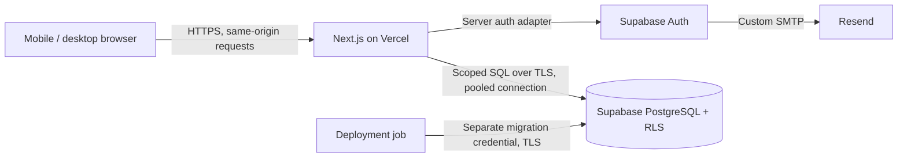

# ADR 0001: Foundation providers and application architecture

Date: 2026-10-30. Decision owner: Logan Barragan (SUR-4 assignee).

Status: **Baseline selected; finalization gated on SUR-5 and SUR-6.** This record
selects an implementation direction, not permission to provision paid services or
process production data. No integrations, infrastructure, or runtime configuration
are implemented by this change.

## Requirements and decision gates

The [project PRD](https://linear.app/lb-sandbox/project/app-foundation-and-mobile-web-experience-7af8e664b8d0)
requires a responsive website with account creation, sign-in/out, persistent own-profile
editing, server-enforced authorization, repeatable deployment, recovery, and safe
diagnostics. Streaming, social, discovery, native apps, and the separate privacy
feature set are outside this foundation.

Inputs include the [SUR-5 proposed v0.1 contract](../account-profile-contracts.md)
at revision `0fc702e0bba56bd25fc18fa2562c9466ed05af98`, published during this review.
It requires immediate application-session revocation, user-action-based idle
expiry, owner-only profiles, and independent application identity. It remains
unapproved. [SUR-6](https://linear.app/lb-sandbox/issue/SUR-6) is in backlog with no
approved numerical quality gates or data obligations. The proposals below must not
be represented as agreed requirements.

Before provider-dependent setup in [SUR-7](https://linear.app/lb-sandbox/issue/SUR-7)
and [SUR-8](https://linear.app/lb-sandbox/issue/SUR-8), Logan must reconcile this record
with those contracts and record the outcome here. A conflicting residency, session,
recovery, or procurement requirement reopens the relevant selection. Production
remains blocked until the data-handling and release gates are resolved.

## Selected stack and alternatives

| Component | Selection and rationale | Limitations and alternative considered |
| --- | --- | --- |
| Web application | TypeScript, React, Next.js App Router, Node.js 24 LTS; one application with server-rendered pages and server route handlers. Pin mutually compatible, maintained framework/SDK versions and a lockfile in SUR-7. | Keeps account UI and server validation together. A Vite SPA plus separate API adds deployment and cross-origin session coordination without a current need. Avoid experimental framework features. |
| Hosting | Vercel Pro, Node.js functions, static assets on its CDN; Git-based previews and controlled production promotion. | Native Next.js deployment reduces initial operations work. Requests have finite duration and payload limits; no persistent worker or streaming infrastructure is selected. Render with a Node container is the fallback if long-lived processes or hosting portability becomes necessary. |
| Authentication | Supabase Auth on a paid Pro organization for credentials and verification, behind server-managed application sessions. Co-location with Postgres simplifies identity/profile authorization. | Provider sessions alone cannot satisfy SUR-5's immediate revocation or user-action idle semantics. The application must enforce both. Password/link-policy compatibility remains a D1 gate. Clerk plus Neon adds cross-provider identity synchronization and deletion/recovery work. |
| Database | Supabase managed PostgreSQL, initially Micro compute for each of production and staging. SQL migrations owned in Git; RLS as defense in depth. | Relational identity/profile constraints and standard PostgreSQL ease migration. Supabase Auth schema/session checks and APIs still create coupling. Neon is a viable PostgreSQL alternative if Auth is separated, but is not selected alongside a second identity provider. |
| Account email | Resend Pro via Supabase custom SMTP for verification and recovery, with a verified sending domain. This is an auth dependency, not marketing infrastructure. | A separate processor handles recipient addresses and message contents. SMTP makes replacement possible. Supabase's default sender is unsuitable for public use; Resend Free's daily cap leaves little burst headroom. |
| File storage | No user-upload bucket in this milestone; profile data stays in PostgreSQL and application assets in Git/CDN. | Avatars/uploads are not an agreed requirement. If SUR-5 adds them, review private object storage, upload limits, malware handling, ownership/deletion, costs, and independent object backups before implementation. |

Firebase Auth plus Firestore was considered as an integrated alternative. It offers
managed authentication, but its document/rules data model would require different
migration and relational-integrity patterns. PostgreSQL better fits the initial
identity/profile relationship and the desired SQL export path. This is a fit
judgment, not a claim that Firebase cannot implement the flows.

## Runtime and integration boundaries

- Browser code renders forms/navigation and calls the same-origin server boundary.
  It never receives database passwords, administrative API keys, or SMTP credentials.
  Keep provider tokens encrypted in a private server-side session store; send only
  an opaque application session cookie with Secure, HttpOnly, SameSite=Lax and
  explicit expiry. Use host-only cookies and server-mediated top-level callbacks;
  validate callback state/PKCE. Protect state-changing requests with origin/CSRF
  checks. Do not cache personalized pages or responses in shared caches.
- A server-only auth adapter verifies identity and resolves the opaque session
  against stored revocation, idle/absolute deadlines, and account status on every
  protected request. Store a hash of the opaque identifier and rotate it at login;
  keep the provider-token encryption key outside the database. Serialize refreshes
  per session using a shared database lock/lease, not per-function memory. Require
  recent authentication within five minutes for sensitive operations.
- A profile service validates input and uses a restricted, non-owner PostgreSQL
  runtime role without BYPASSRLS. Set the trusted actor/session context locally
  within each transaction; never leave it on a pooled connection. RLS checks
  ownership and active session state. Coordinate revocation and writes with
  transaction locking so a request starting after completed revocation is denied.
  Remove application-table grants from Supabase `anon`/`authenticated` Data API
  roles; a provider JWT must not offer a path around application sessions. Keep
  migration/admin credentials separate. Do not trust an ID in form data as an actor.
- Use a stable application account UUID and a unique `(issuer, subject)` mapping
  to account, isolated by environment; never use email as a foreign key. Follow
  SUR-5's verified-only, atomic account/mapping/profile-shell provisioning and
  owner-only display name/version/timestamp projection. Updates compare versions
  atomically. SUR-8 implements this after approval. RLS denies anonymous access
  and protects both reads and writes. Keep editable user
  metadata out of authorization decisions. Do not expose `auth` tables to clients.
- Future streaming, privacy, social, and discovery modules consume the application
  account ID and explicit profile service contracts, not Supabase-specific metadata
  or direct writes to auth tables. Public profile fields, navigation destinations,
  and cross-project access are owned by SUR-5; default to no public profile reads
  until that contract exists. No feature queues, realtime subscriptions, or media
  pipeline are selected here.
- Keep provider SDK use inside auth/data adapters. Export application data using
  PostgreSQL tools; a hosting move can deploy Next.js on a Node server/container.
  An auth-provider move still needs subject mapping, a credential migration or
  password-reset plan, and session invalidation. Portability does not mean a
  zero-effort vendor switch.

## Account lifecycle capability check

Following SUR-5's proposed first-release baseline: email/password sign-up, verified email before
protected access, sign-in/out, and email password recovery. Social login, SMS,
anonymous accounts, and enterprise SSO are deferred pending SUR-5. The table checks
documented support; it does not claim integrated tests have passed.

| Requirement / proposed behavior | Provider support, application responsibility, and acceptance evidence |
| --- | --- |
| Registration and verification | Supabase supports email/password and confirmation. Enable confirmation; allowlist exact callback URLs, use PKCE, and reject unsafe return URLs. Provision only after verification, atomically and idempotently. SUR-9 must test duplicate addresses, expired/reused links, verification on another device, and SMTP failures. |
| Sign-in and protected access | Verify provider issuer/audience/signature/expiry server-side, then resolve application session/account state and enforce RLS. Implement SUR-5's logical operations through same-origin HTTP routes with its error/status mapping. Give generic credential/recovery responses. SUR-9/SUR-10 must test forged cookies, anonymous/cross-account requests, and direct Data API denial. |
| Persistence and expiry | Enforce SUR-5's proposed 7-day absolute and 24-hour idle limits in the application session store. Only authenticated user actions advance idle activity; refresh/background polling do not. Supabase inactivity is refresh-based, so it cannot implement this rule by itself. Pro controls and a proposed 15-minute JWT expiry are additional bounds, not the authorization clock. Test browser restart, idle/absolute expiry, replay, and concurrent refresh. |
| Sign-out and revocation | Revoke current/all application sessions transactionally, then revoke provider refresh credentials and clear cookies/client state. Retry failed provider cleanup without restoring application access. The next protected request must reject the revoked application session even with an unexpired provider JWT; no direct Data API bypass is allowed. Provider-initiated restriction/deletion also needs an active provider-session/account check through a narrowly scoped server function, failing closed on lookup failure. Test offline sign-out as unconfirmed, never successful. |
| Recovery and sensitive changes | Supabase supports reset email and password updates. After reset, revoke all application sessions and require fresh sign-in; password change revokes other sessions, completed email change revokes prior sessions, following SUR-5. Verify recent authentication and new-address confirmation before committing changes. D1 must validate 24-hour verification/30-minute recovery link limits and a scanner-safe confirmation flow: a GET must not consume the token. These details are not confirmed merely by the existence of reset APIs. |
| Password policy | SUR-5 proposes 15–128 Unicode characters, no truncation, and compromised-password checks. Supabase documents bcrypt storage and Pro leaked-password checks; bcrypt's byte-length constraints make the Unicode maximum a specific compatibility risk. D1 must confirm actual provider handling with multi-byte and long-password cases before finalizing Auth. Do not silently shorten the contract or preprocess passwords to bypass vendor limits; incompatibility requires an explicit contract change or a different auth provider. |
| Deletion and retention | Administrative Auth deletion is supported, but existing JWTs remain valid until expiry unless checked against active sessions. Define a retryable deletion workflow covering identity, application rows, future objects, and processor retention. Restore procedures must reapply deletions before reopening traffic. SUR-6 owns retention/erasure obligations; no production deletion promise is established here. |
| Abuse and failures | Configure provider rate limits and password protections; add application throttling without relying on per-function memory. Evaluate CAPTCHA if required by abuse testing. Bound timeouts/retries, fail closed for protected data, preserve safe form state, and never retry mutations blindly. Provider/network failures must not expose raw errors or secrets. |

## Configuration, delivery, and migration responsibilities

- **Environments:** propose local Supabase development, one persistent staging
  project, and one separate production project. Previews use synthetic staging data
  or local/mock services; no production credentials or data. Untrusted fork builds
  receive no secrets. Concurrent schema work must use isolated local databases or
  explicitly budgeted temporary branches, not race staging migrations.
- **Placement:** choose an exact Supabase region after SUR-6 resolves jurisdiction
  and residency. Place Vercel functions nearby where compatible with that decision.
  Primary DB placement alone does not constrain CDN, logs, email, support access,
  or subprocessors. Record those processing locations and contractual commitments
  before real personal data enters staging or production.
- **Configuration:** SUR-7 owns validated, environment-specific URLs, publishable
  keys, callback origins, and server secrets in provider secret stores. Keep
  database/migration credentials, Supabase administrative keys, SMTP keys, and
  deployment tokens out of `NEXT_PUBLIC_*`, source control, logs, and build artifacts.
  Use separate least-privilege credentials, MFA for provider administration, and a
  documented rotation/revocation procedure. Require TLS on all service connections.
- **Migrations:** SUR-8 owns versioned SQL in `supabase/migrations`, including grants,
  RLS, indexes, and mapping constraints. Apply to a clean local DB and an upgraded
  staging DB before production. Use one serialized migration job with a separate
  credential, never migrations during function startup. Runtime uses a small
  bounded pool through Supabase's transaction pooler; avoid session-scoped state
  and unsupported prepared-statement behavior. Migration tools use a supported
  direct/session database connection, accounting for the runner's IPv4/IPv6
  connectivity. SUR-7 verifies driver/pooler compatibility under concurrent load.
- **Release ordering:** use expand/migrate/contract changes. Apply compatible schema
  additions, deploy the app, backfill, then remove old schema only after the rollback
  window. Record migration versions with deployments. Test constraints and RLS for
  two users plus anonymous requests; runtime ownership checks alone are not enough.
- **Rollback:** promote a previous compatible application deployment for application
  regressions. Schema/data recovery is a separate decision: prefer a forward fix;
  destructive migrations require a verified recovery point and a rehearsed restore.
  A hosting rollback does not undo database changes or external email delivery.

## Backups, recovery, and operational visibility

Supabase Pro documents daily database backups with seven days of retention. Use
that as the initial mechanism and propose **RPO 24 hours / RTO 4 hours**, subject to
SUR-6 approval. These are planning targets, not a provider SLA or measured recovery
result. A shorter RPO requires PITR or another validated approach; PITR starts at
about $100/month for seven-day retention and requires at least Small compute.

SUR-8 configures and checks backup availability. SUR-14 must rehearse recovery in an
isolated environment, record actual data loss and elapsed time, verify auth/account
mapping and authorization, restore/reconfigure secrets and custom-role passwords as
needed, invalidate restored application sessions/provider refresh credentials to
prevent resurrected access, and run account/profile smoke tests before allowing traffic. Database
backups do not include Storage object contents or the full external configuration
(Vercel, SMTP, DNS). Record configuration reproducibly without committing secrets.
Determine whether provider backup access is sufficient during an account/provider
outage; SUR-6 owns any independent encrypted-export requirement, its location,
retention, key custody, restore test, and additional cost.

Deletion applies to live records first; backups can retain deleted data for their
retention period. The approved deletion ledger/process must prevent resurrection
after restore. Its storage and retention must be designed in SUR-6/SUR-8 rather
than assumed to survive in the same restored database.

Use Vercel deployment/runtime logs, Supabase database/Auth diagnostics and usage
dashboards, and Resend delivery diagnostics initially. Emit an allowlisted set of
request ID, route template, status/error code, duration, deployment version, and
dependency name. Never log passwords, tokens, cookies, request bodies, email
addresses, profile fields, or verification/recovery URL query strings. Provider
email/auth logs may themselves contain personal data; review their access and
retention separately from application log redaction.

Vercel Pro runtime logs retain one day; Supabase Pro lists seven-day log retention.
These are short troubleshooting windows, not a durable audit system. SUR-13 must
configure uptime/error/latency and resource/billing alerts, verify an injected
failure reaches the operational owner, and document access and triage. If SUR-6
requires longer retention or paging coverage, select and price an export/monitoring
service before release. Proposed availability target is 99.5% monthly for core
journeys; paid entry tiers do not establish an end-to-end availability guarantee.

## Capacity, cost, and provider limits

Planning envelope, not measured demand: one developer seat, one production and one
staging database, 1,000 MAU, 100 DAU, 20 concurrent active users, and a peak of 10
application requests/second. Budget 100,000 dynamic requests/month at roughly 200 ms
active CPU each (about 5.6 CPU-hours; memory time and transfer are billed separately),
1 GB database data including indexes per project, 10 GB/month database egress,
20 GB/month web delivery, and 3,000 auth emails/month with bursts up to 100/hour.
No video, uploads, realtime, read replicas, or per-preview databases are included.
SUR-13 must load-test representative account/profile journeys; user count is not a
database-throughput guarantee.

Indicative USD monthly prices from the linked provider pages, checked 2026-10-30:

| Item | Initial allowance | Cost assumption |
| --- | --- | --- |
| Vercel Pro | One developer seat, usage within included credit | $20/month baseline; $20 usage credit is not an additional discount on the seat charge. Actual CPU, memory, transfer, and add-ons can increase the bill. |
| Supabase Pro | Two Micro projects, one organization | $25 plan + $20 compute - $10 organization compute credit = about $35/month. Quotas include 100,000 MAU, 8 GB disk per project, and 250 GB egress; verify quota scope across projects when provisioning. |
| Resend Pro | 50,000 transactional emails/month | $20/month; selected for burst headroom over Free's 100/day limit, despite lower expected monthly volume. |
| Total | Baseline recurring services | About **$75/month**; propose a **$100/month operating budget** before taxes, domain registration, overages, independent backup storage, longer log retention, PITR, or additional seats. This is not a hard all-in cap. |

Important ceilings and review triggers:

- Supabase Micro lists 1 GB RAM, 60 direct connections, and 200 pooler connections.
  Avoid a direct connection per function invocation. Review compute/query plans if
  memory, connections, or latency remain near limits. Include session lookup,
  refresh locking, and revocation checks in load tests; database-backed sessions
  add latency and make database availability part of every protected request.
- Vercel Node functions with Fluid compute document a 300-second default duration
  and 800-second generally available Pro maximum, and a 4.5 MB request/response
  payload limit. Configure a short bounded request timeout for account/profile
  operations; this platform is not the future media pipeline.
- Supabase's default email sender is restricted to team addresses and currently
  two messages/hour. Custom SMTP initially has a 30-message/hour limit; explicitly
  configure and test a limit supporting the proposed 100/hour peak, with abuse
  controls. Purchasing an email plan does not change Auth rate limits automatically.
- Set billing notifications at 50%, 80%, and 100% of the approved budget and review
  usage weekly during launch. Configure Vercel spend controls and Supabase's spend
  cap deliberately; neither should be assumed to cap every service/add-on. Decide
  how exhausted quotas affect availability. Re-estimate on doubled demand, any
  sustained performance failure, or a new upload/streaming requirement.

## Unresolved decisions and handoff owners

Logan Barragan is the accountable owner below because he is the assignee of the
referenced issues. These are follow-up responsibilities, not claims of approval;
he can record a delegated specialist/reviewer in the corresponding issue.

| Decision / evidence needed | Owner and tracking | Required before |
| --- | --- | --- |
| Approve D1/D2 and resolve password-length and link-lifetime/scanner behavior compatibility; validate server-managed immediate revocation, action-based idle expiry, recent auth, and refresh serialization. | Logan — [SUR-5](https://linear.app/lb-sandbox/issue/SUR-5), implemented/tested in SUR-9 | Final provider selection and auth setup |
| Approve profile fields/visibility, identity mapping, provisioning/deletion contract, and downstream navigation/data-access boundaries. | Logan — SUR-5 with streaming/privacy/social/discovery reviewers | SUR-8 schema and dependent feature integration |
| Approve environments, exact region, processors/subprocessors, jurisdiction, retention/erasure, consent, and independent backup requirements. | Logan — [SUR-6](https://linear.app/lb-sandbox/issue/SUR-6), with a named privacy reviewer | Region-dependent setup; all real personal data and production use |
| Approve usage envelope, $100 budget, billing ownership, sending domain, and exact purchased plans; re-price any changed requirements. | Logan — SUR-4/SUR-6, configured in SUR-7 | Paid provisioning |
| Confirm RPO/RTO, availability, log retention, operational responder and release reviewer; choose PITR/export/monitoring add-ons if needed. | Logan — SUR-6; SUR-8/SUR-13/SUR-14 supply evidence | Recovery setup and release sign-off |
| Agree device/browser/network matrix, WCAG target, and page-load/auth/profile-save/navigation budgets; verify region latency and capacity. | Logan — SUR-6; SUR-12/SUR-13 supply evidence | Implementation acceptance criteria and release |
| Pin supported runtime/dependencies; prove isolated configuration, repeatable migrations, authorization, and rollback/restore. | Logan — SUR-7/SUR-8/SUR-9/SUR-14 | Non-production handoff, then production release |

SUR-4's provider evaluation is recorded here. Its requirement to confirm support
against **agreed** contracts remains gated on SUR-5/SUR-6; documentation research
alone cannot close that acceptance criterion. Finalization must record the contract
versions, resolved exceptions, and decision owner/date. SUR-15 consumes the resulting
release evidence; this ADR must not be used as evidence that a deployment or recovery
test has already run.

## Provider references

Pricing and limits change; recheck before provisioning. Sources inspected for this
decision on 2026-10-30:

- [Vercel pricing](https://vercel.com/pricing), [function limits](https://vercel.com/docs/functions/limitations), and [runtime logs](https://vercel.com/docs/observability/runtime-logs).
- [Next.js deployment options](https://nextjs.org/docs/app/getting-started/deploying) and [Render Next.js deployment](https://render.com/docs/deploy-nextjs-app).
- [Supabase pricing and compute](https://supabase.com/pricing), [session controls](https://supabase.com/docs/guides/auth/sessions), and [sign-out semantics](https://supabase.com/docs/guides/auth/signout).
- [Supabase custom SMTP](https://supabase.com/docs/guides/auth/auth-smtp) and [Resend pricing](https://resend.com/pricing).
- [Supabase password security](https://supabase.com/docs/guides/auth/password-security).
- [Supabase user data and deletion](https://supabase.com/docs/guides/auth/managing-user-data), [RLS](https://supabase.com/docs/guides/database/postgres/row-level-security), and [migrations](https://supabase.com/docs/guides/deployment/database-migrations).
- [Supabase backups](https://supabase.com/docs/guides/platform/backups) and [regions/data location](https://supabase.com/docs/guides/platform/regions).
- [Firebase authentication](https://firebase.google.com/docs/auth), [Neon PostgreSQL migration](https://neon.com/docs/import/migrate-from-postgres), and [Clerk webhook integration](https://clerk.com/docs/guides/development/webhooks/overview).
